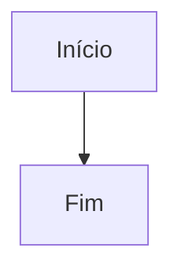

# Amostra de exportação

Parágrafo com **negrito**, *itálico*, ~~tachado~~, `código em linha` e um [link](https://exemplo.org/pagina?a=1&b=2). Acentuação: ação, coração, órgão, à, ü.

## Listas

- item um
- [x] tarefa feita
- [ ] tarefa aberta
  - sub-item
    - sub-sub-item

3. terceiro
4. quarto

## Citações e alertas

> Uma citação simples.

> [!WARNING]
> Faça backup antes de continuar.

## Código

```rust
fn main() {
    println!("olá, mundo");
}
```

## Tabela

| Nome | Valor | Obs |
|:-----|------:|:---:|
| alfa | 1 | x |
| beta | 22 | y |

---




Fim da amostra.
