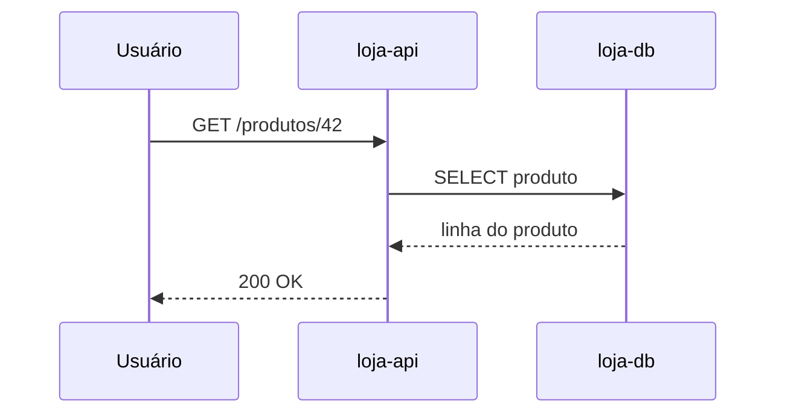
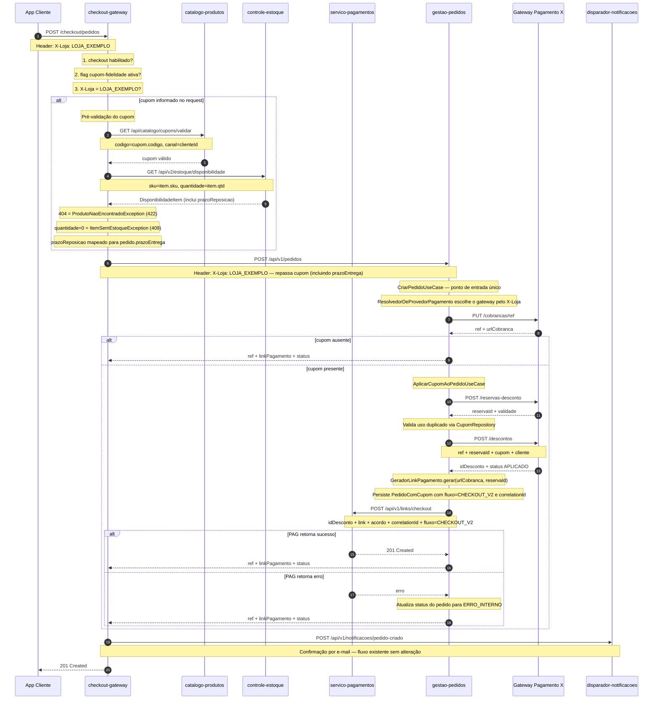
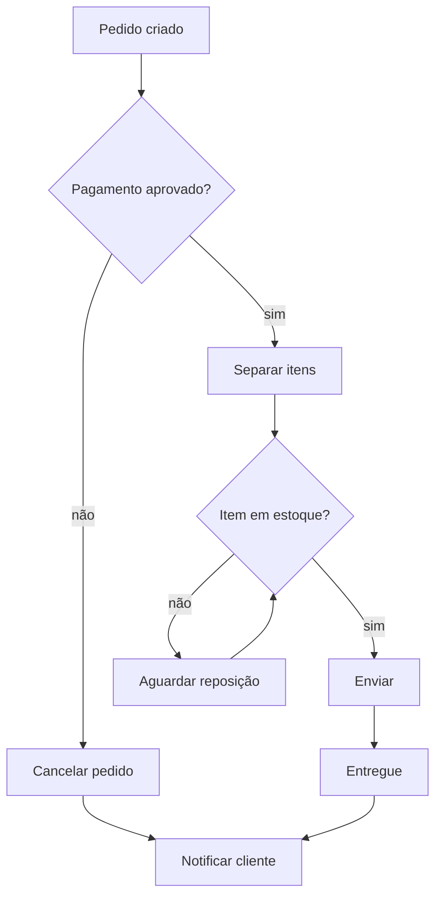

# Diagramas Mermaid para testar o zoom

Amostra com dados fictícios para conferir o zoom de diagramas (`i`). Role até um diagrama,
aperte `i` e use `+`/`-`, `h`/`j`/`k`/`l`, espaço/`b`, `g`/`G` e `0`.

## 1. Diagrama pequeno (cabe na tela)

Serve de referência: deve ficar legível mesmo sem zoom.

## 2. Diagrama grande (precisa de zoom)

Checkout de uma loja fictícia: 8 participantes, nomes longos, notas e blocos `alt` aninhados.
Na tela inteira o texto fica ilegível; com `i` dá para aproximar e andar pelo diagrama.

## 3. Fluxograma (outro tipo de diagrama)

Confere que o zoom também serve para diagramas que não são de sequência.

